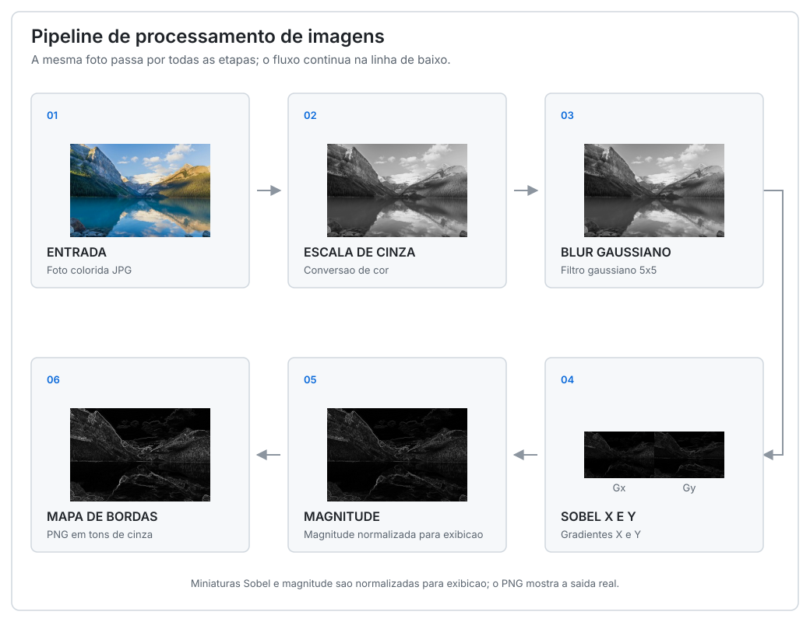
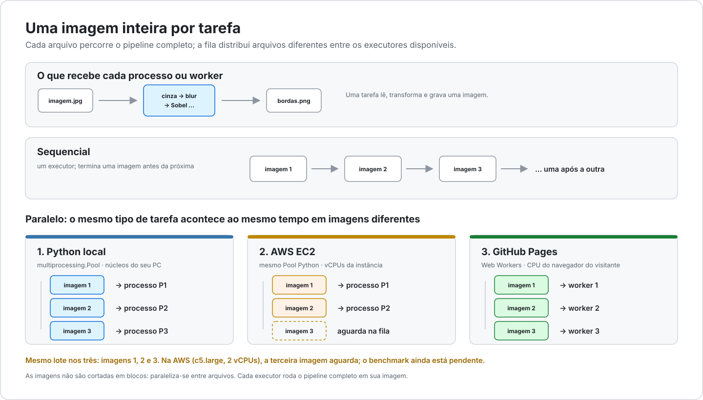
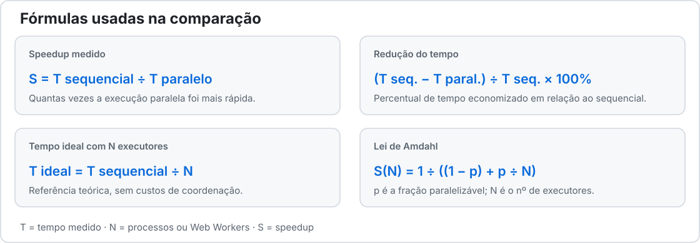

# Pipeline de processamento paralelo de imagens

<p align="center">
  <picture>
    <source media="(prefers-color-scheme: dark)" srcset="assets/logo/logo-dark-v2.png">
    <source media="(prefers-color-scheme: light)" srcset="assets/logo/logo.png">
    
  </picture>
</p>

<p align="center">
  <a href="https://github.com/lianeheidemann/parallel-image-pipeline/actions/workflows/ci.yml"></a>
  <a href="https://github.com/lianeheidemann/parallel-image-pipeline/actions/workflows/pages.yml"></a><br>
  
  
  
  
  
  
  
</p>

Este repositório implementa um pipeline que transforma imagens JPG em mapas de bordas PNG e compara sua execução sequencial e paralela, processando uma imagem inteira por tarefa. No código, você encontrará o processador e o benchmark Python local em [`code/local/`](code/local/), os scripts de preparação e o painel para AWS EC2 em [`code/aws/`](code/aws/), a aplicação JavaScript com Web Workers em [`code/web/`](code/web/), e as ferramentas que comparam as medições e geram os gráficos em [`code/analysis/`](code/analysis/). Os conjuntos de imagens estão em [`dataset/`](dataset/) e as instruções e resultados detalhados em [`doc/`](doc/).

> **Estado atual:** o código local e a página web têm medições registradas. A parte AWS está preparada no repositório, mas ainda precisa ser configurada e executada em uma instância EC2. Por isso, os gráficos não apresentam uma medição AWS.

**Navegação:** [Tecnologias e versões](#tecnologias-e-versoes) · [Como funciona](#como-funciona) · [Dados e amostra](#dados-e-amostra) · [Resultados](#resultados-do-benchmark) · [Estrutura](#estrutura-do-projeto) · [Execução](#executar-e-publicar)

## Tecnologias e versões

<div style="width:100%; overflow-x:auto;">
<table border="1" cellpadding="8" cellspacing="0" width="100%" style="border-collapse:collapse; color:inherit;">
  <thead>
    <tr>
      <th style="border:1px solid currentColor; text-align:left;">Tecnologia</th>
      <th style="border:1px solid currentColor; text-align:left;">Versão ou requisito</th>
      <th style="border:1px solid currentColor; text-align:left;">Uso</th>
    </tr>
  </thead>
  <tbody>
    <tr><td style="border:1px solid currentColor;">Python</td><td style="border:1px solid currentColor;">3.10+; CI executa com 3.10 e 3.12</td><td style="border:1px solid currentColor;">Pipeline local e benchmark Python na AWS</td></tr>
    <tr><td style="border:1px solid currentColor;">OpenCV (<code>opencv-python-headless</code>)</td><td style="border:1px solid currentColor;">4.9+</td><td style="border:1px solid currentColor;">Tratamento de imagem no Python</td></tr>
    <tr><td style="border:1px solid currentColor;">NumPy</td><td style="border:1px solid currentColor;">1.26+</td><td style="border:1px solid currentColor;">Operações com matrizes de pixels</td></tr>
    <tr><td style="border:1px solid currentColor;">Pillow</td><td style="border:1px solid currentColor;">10.0+</td><td style="border:1px solid currentColor;">Leitura, geração e gravação de imagens</td></tr>
    <tr><td style="border:1px solid currentColor;">JavaScript</td><td style="border:1px solid currentColor;">Versão do navegador; módulos ES e Web Workers, sem versão fixada no repositório</td><td style="border:1px solid currentColor;">Pipeline e benchmark no navegador</td></tr>
    <tr><td style="border:1px solid currentColor;">Node.js</td><td style="border:1px solid currentColor;">22 no CI</td><td style="border:1px solid currentColor;">Testes web e ferramenta de benchmark do navegador</td></tr>
    <tr><td style="border:1px solid currentColor;">Playwright</td><td style="border:1px solid currentColor;">1.63.0</td><td style="border:1px solid currentColor;">Automação do navegador para o benchmark web</td></tr>
    <tr><td style="border:1px solid currentColor;">AWS EC2</td><td style="border:1px solid currentColor;"><code>c5.large</code> com Ubuntu 24.04, configuração planejada</td><td style="border:1px solid currentColor;">Execução remota do benchmark Python; instância ainda não configurada</td></tr>
    <tr><td style="border:1px solid currentColor;">GitHub Actions</td><td style="border:1px solid currentColor;"><code>checkout@v4</code>; <code>setup-python@v5</code>; <code>setup-node@v4</code>; publicação com <code>configure-pages@v5</code>, <code>upload-pages-artifact@v3</code> e <code>deploy-pages@v4</code></td><td style="border:1px solid currentColor;">CI e publicação do GitHub Pages</td></tr>
    <tr><td style="border:1px solid currentColor;">GitHub Pages</td><td style="border:1px solid currentColor;">Serviço gerenciado, sem versão definida pelo projeto</td><td style="border:1px solid currentColor;">Hospedagem da página web</td></tr>
  </tbody>
</table>
</div>

<p align="center"><em>Tabela 1 — Tecnologias e versões usadas ou exigidas pelo projeto.</em></p>

As versões das dependências Python são requisitos mínimos declarados em `requirements.txt`, não versões exatas travadas. A versão do JavaScript depende do navegador que abre a página.

## Como funciona

### Etapas do tratamento de imagem

<p align="center"></p>

<p align="center"><em>Imagem 1 — Etapas do tratamento aplicado a cada imagem.</em></p>

O pipeline lê o JPG, converte para escala de cinza, aplica um blur gaussiano 5×5, calcula os gradientes Sobel horizontal e vertical, combina esses gradientes em uma magnitude de borda e grava um PNG. A implementação Python está em [`code/local/image_processor.py`](code/local/image_processor.py); a versão JavaScript está em [`code/web/assets/pipeline.js`](code/web/assets/pipeline.js).

### Como o paralelismo é feito

<p align="center"></p>

<p align="center"><em>Imagem 2 — Distribuição das mesmas imagens entre os executores dos três ambientes.</em></p>

O trabalho é dividido **por imagem**: cada processo ou worker recebe um arquivo inteiro, aplica todas as etapas do pipeline e grava seu próprio resultado. As imagens não são subdivididas em blocos menores. Como cada imagem é independente, várias podem ser processadas ao mesmo tempo.

| Ambiente | Código | Execução paralela | Onde roda o cálculo |
|---|---|---|---|
| Python local | [`code/local/`](code/local/) | `multiprocessing.Pool`; uma imagem por processo | Núcleos da CPU do computador |
| AWS EC2 | [`code/aws/`](code/aws/) e o mesmo código de [`code/local/`](code/local/) | `multiprocessing.Pool`; uma imagem por processo | A `c5.large` tem 2 vCPUs; o benchmark prevê 2, 4 e 8 processos para comparar a capacidade e a sobrecarga |
| GitHub Pages | [`code/web/`](code/web/) | Web Workers; uma imagem por worker | Navegador e CPU do computador de quem abriu a página |

<p align="center"><em>Tabela 2 — Ambientes, mecanismo de paralelismo e local de execução.</em></p>

GitHub Pages hospeda os arquivos da página; ele não processa as imagens em seus servidores. O navegador processa localmente as imagens selecionadas. Na versão Python, um `Lock` protege somente o contador e o registro no CSV; o tratamento dos pixels fica fora dessa seção crítica e continua paralelo.

#### Processamento sequencial e paralelo

No modo sequencial, uma única linha de execução processa as imagens uma após a outra. No paralelo, vários processos ou workers executam o mesmo trabalho simultaneamente em imagens diferentes. Isso pode reduzir o tempo total quando há núcleos disponíveis. O ganho não é necessariamente proporcional ao número de processos: criação e encerramento de workers, leitura e gravação de arquivos e outras etapas que não se dividem continuam tendo custo.

O benchmark Python compara as saídas paralelas e sequenciais por SHA-256. O benchmark da página compara os pixels. As medições usam a mediana de três rodadas.

#### Vantagens de cada ambiente

- **Python local:** usa vários núcleos da CPU para processar imagens simultaneamente. Os processos separados também permitem paralelizar trabalho intensivo em CPU sem a limitação do GIL.
- **AWS EC2:** executa o trabalho numa máquina virtual dedicada, sem ocupar a CPU do computador local. A capacidade pode ser alterada escolhendo uma instância com mais vCPUs.
- **GitHub Pages:** publica a demonstração sem manter um servidor de processamento. Os Web Workers processam as imagens no navegador e mantêm a interface responsiva.

Em qualquer ambiente, o ganho depende do tamanho do lote e dos recursos disponíveis. Para poucas imagens, o custo de iniciar e coordenar processos ou workers pode reduzir o benefício.

## Dados e amostra

### Antes e depois do tratamento

Para visualizar o efeito do pipeline, usamos uma fotografia de paisagem nítida, salva em [`assets/exemple/`](assets/exemple/). A imagem original passa por escala de cinza, blur gaussiano e detecção de bordas Sobel:

<figure align="center" style="border:1px solid currentColor; border-radius:8px; padding:10px; margin:1em 0;">
  <p align="center">
    
    
  </p>
  <figcaption align="center"><em>Imagem 3 — Antes e depois do tratamento: foto original à esquerda e mapa de bordas à direita. Fonte: foto de <a href="https://unsplash.com/photos/a-lake-surrounded-by-mountains-under-a-blue-sky-2HFe1VFPlyQ">Philip Ho / Unsplash</a>; resultado gerado pelo pipeline deste repositório.</em></figcaption>
</figure>

O dataset usado na comparação entre os três ambientes continua sendo [`dataset/dataset-100/`](dataset/dataset-100/), com **100 imagens JPG de 1920×1080**. A fotografia acima serve apenas para ilustrar o antes e depois do tratamento.

Também há [`dataset/dataset-2000/`](dataset/dataset-2000/), com **2000 imagens de 640×480**, armazenadas via Git LFS. Esse conjunto maior é usado nos benchmarks Python local e AWS; não é o dataset da comparação publicada entre os três ambientes. Para baixar seus arquivos após clonar o repositório, use `git lfs install` e `git lfs pull`.

## Resultados do benchmark

Os gráficos em [`output/graficos/`](output/graficos/) foram gerados a partir de [`doc/analysis/comparacao.md`](doc/analysis/comparacao.md). As medições disponíveis usam as mesmas 100 imagens e foram feitas no Intel Core i7-12700H com Windows 11 e 20 núcleos lógicos. A AWS ainda não foi medida.

### Resumo comparativo

<div style="width:100%; overflow-x:auto;">
<table border="1" cellpadding="8" cellspacing="0" width="100%" style="border-collapse:collapse; color:inherit;">
  <thead>
    <tr>
      <th style="border:1px solid currentColor; text-align:center;">Ambiente</th>
      <th style="border:1px solid currentColor; text-align:center;">Sequencial</th>
      <th style="border:1px solid currentColor; text-align:center;">Paralelo mais rápido</th>
      <th style="border:1px solid currentColor; text-align:center;">Speedup</th>
      <th style="border:1px solid currentColor; text-align:center;">Situação</th>
    </tr>
  </thead>
  <tbody>
    <tr><td style="border:1px solid currentColor; text-align:center;">Python local</td><td style="border:1px solid currentColor; text-align:center;">7,88 s</td><td style="border:1px solid currentColor; text-align:center;">2,52 s (8 processos)</td><td style="border:1px solid currentColor; text-align:center;">3,13×</td><td style="border:1px solid currentColor; text-align:center;">Medido</td></tr>
    <tr><td style="border:1px solid currentColor; text-align:center;">AWS EC2</td><td style="border:1px solid currentColor; text-align:center;">Pendente</td><td style="border:1px solid currentColor; text-align:center;">Pendente (2, 4 e 8 processos)</td><td style="border:1px solid currentColor; text-align:center;">Pendente</td><td style="border:1px solid currentColor; text-align:center;">Benchmark ainda não executado</td></tr>
    <tr><td style="border:1px solid currentColor; text-align:center;">GitHub Pages</td><td style="border:1px solid currentColor; text-align:center;">72,63 s</td><td style="border:1px solid currentColor; text-align:center;">8,76 s (8 Web Workers)</td><td style="border:1px solid currentColor; text-align:center;">8,29×</td><td style="border:1px solid currentColor; text-align:center;">Medido</td></tr>
  </tbody>
</table>
</div>

<p align="center"><em>Tabela 3 — Resumo dos tempos e speedups por ambiente. Fonte: medições registradas em <a href="doc/analysis/comparacao.md">doc/analysis/comparacao.md</a>.</em></p>

### Gráficos de desempenho

#### Tempo sequencial e melhor tempo paralelo

<p align="center"></p>

<p align="center"><em>Imagem 4 — Comparação entre o tempo sequencial e o melhor tempo paralelo medido. Fonte: <code>doc/analysis/comparacao.md</code>.</em></p>

#### Tempo por quantidade de processos ou Web Workers

<p align="center"></p>

<p align="center"><em>Imagem 5 — Tempo medido para cada quantidade de processos ou Web Workers. Fonte: <code>doc/analysis/comparacao.md</code>.</em></p>

### Fórmulas usadas nos cálculos

<p align="center"></p>

<p align="center"><em>Imagem 6 — Fórmulas usadas para calcular speedup, redução do tempo e tempo ideal. Fonte: <code>assets/diagramas/formulas-desempenho.svg</code>.</em></p>

`T sequencial` é o tempo com um executor; `T paralelo` é o tempo medido com vários processos ou workers. O tempo ideal é uma referência matemática: o processamento real também tem custos de coordenação e acesso a arquivos.

#### Lei de Amdahl nos três ambientes

<p align="center"></p>

<p align="center"><em>Imagem 7 — Fórmula da Lei de Amdahl. Fonte: <code>assets/diagramas/lei-de-amdahl.svg</code>.</em></p>

A Lei de Amdahl se aplica aos três ambientes porque descreve a mesma relação: uma parte do trabalho precisa ocorrer em sequência, enquanto outra pode ser dividida entre executores. Ela não depende de o executor ser um processo Python local, um processo na EC2 ou um Web Worker no navegador. Para que a estimativa seja útil, cada ambiente precisa ser medido com o mesmo trabalho sequencial e paralelo, e sua fração paralelizável `p` deve ser estimada a partir das próprias medições. O hardware e os custos de cada ambiente mudam o resultado. Na AWS, as medições ainda estão pendentes; no navegador, os tempos registrados não produzem uma estimativa Amdahl consistente, então a fórmula é válida como modelo, mas não como previsão confiável para esses dados.

### Cálculos detalhados por ambiente

#### Python local: cálculo sequencial e com 8 processos

O tempo sequencial é a referência. Com 8 processos, o tempo caiu de 7,88 s para 2,52 s: redução de **68%** e speedup de **3,13×**. Uma aceleração ideal de 8× levaria 0,985 s. Parte do trabalho não se divide entre processos; também há custos de iniciar o pool, agendar tarefas e ler e gravar arquivos, além da disputa por CPU, memória e disco. Pela medição com 2 processos, a Lei de Amdahl estima que cerca de **79%** do trabalho é paralelizável e limita o speedup teórico a aproximadamente **4,7×**. **Os 20 processadores lógicos descrevem a máquina; 8 processos foi a maior configuração testada.** O benchmark não mediu 20 processos.

```text
Sequencial (1 processo) = 7,88 s
Paralelo (8 processos)  = 2,52 s
Reducao                 = (7,88 - 2,52) / 7,88 x 100 = 68,0%
Speedup                 = 7,88 / 2,52 = 3,13x
Tempo ideal com 8       = 7,88 / 8 = 0,985 s (aprox. 0,98 s)
```

#### AWS EC2: cálculo pendente

A configuração AWS está preparada, mas a instância ainda não foi executada. Sem tempos sequencial e paralelo medidos na mesma EC2, não é possível calcular a redução de tempo, o speedup nem estimar a fração paralelizável. O benchmark prevê comparar 1, 2, 4 e 8 processos na `c5.large`, que tem 2 vCPUs. Assim, 4 e 8 processos excedem as vCPUs disponíveis e servem para medir o efeito dessa sobrecarga; os resultados podem ser mais lentos. Os tempos ideais são referências teóricas, não resultados do benchmark.

```text
Sequencial (1 processo) = aguardando benchmark na EC2
Paralelo (2 processos) = aguardando benchmark na EC2
Paralelo (4 processos) = aguardando benchmark na EC2 (acima de 2 vCPUs)
Paralelo (8 processos) = aguardando benchmark na EC2 (acima de 2 vCPUs)
Reducao e speedup       = calculados quando houver os tempos medidos
```

#### GitHub Pages: cálculo sequencial e com 8 Web Workers

O navegador levou 72,63 s sequencialmente e 8,76 s com 8 Web Workers: redução de **88%** e speedup registrado de **8,29×**. O tempo ideal para 8× seria 9,079 s, cerca de 0,32 s acima do medido. Esse resultado é o speedup calculado a partir dos tempos registrados, não uma garantia de que 8 workers sempre resultarão em mais de 8×. As medições com 2 e 8 workers também não seguem uma estimativa consistente pela Lei de Amdahl; por isso, não apresentamos um limite Amdahl para o navegador.

```text
Sequencial (1 thread)        = 72,63 s
Paralelo (8 Web Workers)     = 8,76 s
Reducao                      = (72,63 - 8,76) / 72,63 x 100 = 88,0%
Speedup                      = 72,63 / 8,76 = 8,29x
Tempo ideal com 8 workers    = 72,63 / 8 = 9,079 s (aprox. 9,08 s)
```

## Estrutura do projeto

| Pasta | Conteúdo |
|---|---|
| [`code/local/`](code/local/) | Pipeline Python, modos sequencial e paralelo, verificação e benchmark |
| [`code/aws/`](code/aws/) | Script de inicialização da EC2 e painel HTTP para consultar os resultados |
| [`code/web/`](code/web/) | Página web, pipeline JavaScript e execução com Web Workers |
| [`code/analysis/`](code/analysis/) | Coleta dos tempos e geração do relatório e gráficos de comparação |
| [`dataset/`](dataset/) | Conjuntos de imagens de entrada |
| [`output/graficos/`](output/graficos/) | Gráficos SVG versionados |
| [`doc/`](doc/) | Manual de execução e relatório detalhado das medições |

<p align="center"><em>Tabela 4 — Pastas principais do repositório e seus conteúdos. Fonte: organização atual dos arquivos do projeto.</em></p>

## Executar e publicar

### AWS: configuração ainda necessária

O repositório inclui o script [`code/aws/user-data.sh`](code/aws/user-data.sh), que instala dependências na primeira inicialização, clona o repositório, executa os benchmarks e disponibiliza um painel pelo [`code/aws/server.py`](code/aws/server.py). **A instância EC2 ainda precisa ser criada e configurada na conta AWS**; o repositório não contém credenciais, chave privada nem resultados de uma execução AWS concluída.

O guia com os passos de criação, rede, chave e execução está em [`code/aws/README.md`](code/aws/README.md). Depois da execução, o painel da instância fornece o CSV para completar o comparativo. Para testar o painel sem AWS, rode `python code/aws/server.py` e abra `http://localhost:8080/`.

### Executar localmente

Requisitos: Python 3.10+ e dependências listadas em [`requirements.txt`](requirements.txt).

```bash
python -m venv .venv
```

Ative o ambiente virtual e instale os pacotes:

```bash
# Windows PowerShell
.venv\Scripts\Activate.ps1
pip install -r requirements.txt
```

Rode o benchmark local com o conjunto usado na comparação:

```bash
python code/local/benchmark.py --dataset dataset/dataset-100 --workers 2 4 8 --repeat 3
```

Para instruções completas sobre execução local, AWS, GitHub Pages e comparação dos cenários, consulte [`doc/manual-de-execucao.md`](doc/manual-de-execucao.md).

### GitHub Pages

A página publicada é [lianeheidemann.github.io/parallel-image-pipeline](https://lianeheidemann.github.io/parallel-image-pipeline/). Selecione imagens e escolha o número de Web Workers para executar o benchmark no navegador. O fluxo de publicação está em [`.github/workflows/pages.yml`](.github/workflows/pages.yml) e atualiza a página quando há mudanças em `code/web/` na branch `main`.
