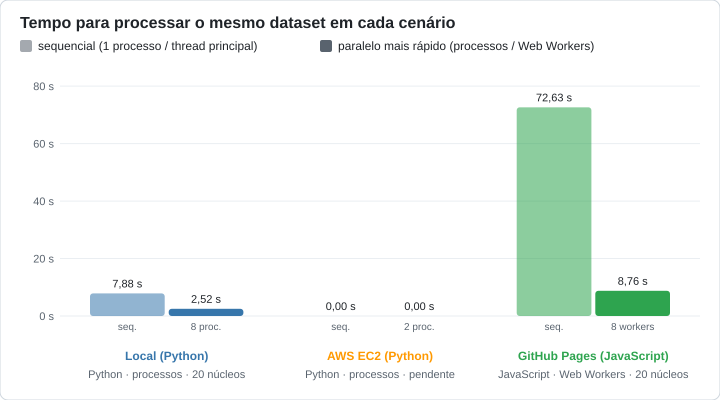
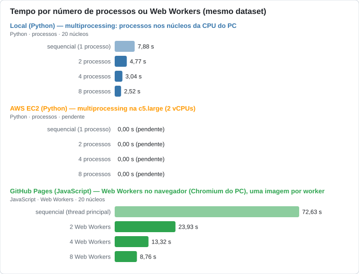

# Tempo de processamento: Local (Python) × AWS EC2 (Python) × GitHub Pages (JavaScript)

Gerado em 20/10/2026 10:40 por `python code/analysis/comparar.py`.

## Cenários

- **Local (Python)** — multiprocessing: processos nos núcleos da CPU do PC: 100 imagens 1920x1080
  - maquina: 12th Gen Intel(R) Core(TM) i7-12700H; nucleos: 20 logicos; sistema: Windows 11, Python 3.13.3; energia: carregador ligado; data: 20/10/2026 08:34
- **AWS EC2 (Python)** — multiprocessing na c5.large (2 vCPUs): **pendente** (sem resultado ainda; aparece zerado)
- **GitHub Pages (JavaScript)** — Web Workers no navegador (Chromium do PC), uma imagem por worker: 100 imagens 1920x1080
  - maquina: 12th Gen Intel(R) Core(TM) i7-12700H; nucleos: 20 logicos; sistema: Windows 11, Python 3.13.3; energia: carregador ligado; navegador: Chromium headless abrindo https://lianeheidemann.github.io/parallel-image-pipeline/; data: 20/10/2026 08:35

## Tempos medidos (mediana das rodadas)

| Cenário | Linguagem | Execução | Tempo (s) | Speedup | Verificado |
|---|---|---|---:|---:|:---:|
| Local | Python | sequencial (1 processo) | 7,88 | 1,00× | — |
| Local | Python | 2 processos | 4,77 | 1,65× | sim |
| Local | Python | 4 processos | 3,04 | 2,59× | sim |
| Local | Python | 8 processos | 2,52 | 3,13× | sim |
| AWS EC2 | Python | sequencial (1 processo) | 0,00 (pendente) | — | — |
| AWS EC2 | Python | 2 processos | 0,00 (pendente) | — | — |
| AWS EC2 | Python | 4 processos | 0,00 (pendente) | — | — |
| AWS EC2 | Python | 8 processos | 0,00 (pendente) | — | — |
| GitHub Pages | JavaScript | sequencial (thread principal) | 72,63 | 1,00× | — |
| GitHub Pages | JavaScript | 2 Web Workers | 23,93 | 3,04× | sim |
| GitHub Pages | JavaScript | 4 Web Workers | 13,32 | 5,45× | sim |
| GitHub Pages | JavaScript | 8 Web Workers | 8,76 | 8,29× | sim |

## Comparação direta

| Cenário | Sequencial (s) | Em relação ao mais rápido | Paralelo mais rápido (s) | Com | Em relação ao mais rápido |
|---|---:|---|---:|---:|---|
| Local (Python) | 7,88 | mais rápido | 2,52 | 8 processos | mais rápido |
| GitHub Pages (JavaScript) | 72,63 | 9,22× mais lento | 8,76 | 8 Web Workers | 3,48× mais lento |

## Resumo

- **Local (Python)**: sequencial 7,88 s; paralelo mais rápido 2,52 s com 8 processos (speedup 3,13×)
- **GitHub Pages (JavaScript)**: sequencial 72,63 s; paralelo mais rápido 8,76 s com 8 Web Workers (speedup 8,29×)

## Gráficos

## Como ler

Os três cenários processam as mesmas imagens com o mesmo pipeline (cinza → blur → Sobel), mas diferem em hardware, na linguagem (Python com OpenCV no PC e na AWS, JavaScript no navegador) e na unidade paralela: em Python, `multiprocessing` cria **processos** que o sistema distribui pelos **núcleos** da CPU; no navegador, **Web Workers** (que o navegador também distribui pelos núcleos do PC). Nos dois, cada imagem inteira vai para um processo ou worker, e o tempo cobre as mesmas 6 etapas por imagem: ler o JPG, cinza, blur, Sobel X/Y, magnitude e gerar o PNG (a geração do dataset não entra). Um cenário ainda sem resultado aparece com tempos zerados. Os segundos mostram quanto tempo cada cenário precisa para o mesmo trabalho; o *speedup* mostra quanto cada um ganha ao paralelizar.
